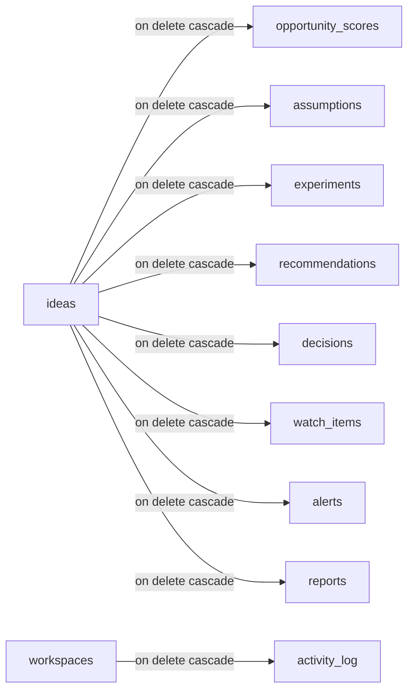

# Database Indexes Runbook — Migration 006 (Tirth Bhanderi)

| Metadata | Details |
| :--- | :--- |
| **Service** | `db/migrations` (Postgres 16 + pgvector) |
| **Component** | Migration `006_indexes` — FK/query indexes for the `003`/`004` tables |
| **Owner / Squad** | Tirth Bhanderi (`tirthbhanderi2006`) / WS1 Core Backend |
| **Sprint / Issue** | Sprint 1 — Issue #5 (`S1-5 Migration 006 indexes for 003/004 tables`) |
| **Status** | In review |
| **Last Updated** | October 2026 |

---

## 1. Why this migration exists

Postgres automatically indexes primary keys and unique constraints but **never foreign keys**.
Before `006`, every FK in the decision layer (`003_decision_layer.sql`) and the
radar/reports/billing tables (`004_radar_reports_billing.sql`) was unindexed, which meant:

- `on delete cascade` from `ideas` / `workspaces` had to sequentially scan the child tables;
- per-idea list queries (assumption board, experiments, alerts inbox, reports list) and the
  workspace activity feed could not use an index.

`006_indexes.sql` indexes every FK column of the nine tables listed in issue #5 and adds the
query column used by each table's primary list/filter pattern.

## 2. Index catalog

| # | Index name | Table | Columns | FK covered | Query served |
| :--- | :--- | :--- | :--- | :--- | :--- |
| 1 | `opportunity_scores_idea_id_created_at_idx` | `opportunity_scores` | `(idea_id, created_at desc)` | `idea_id` | latest score per idea |
| 2 | `opportunity_scores_run_id_idx` | `opportunity_scores` | `(run_id)` | `run_id` | scores produced by a run |
| 3 | `assumptions_idea_id_status_idx` | `assumptions` | `(idea_id, status)` | `idea_id` | assumption board by status |
| 4 | `experiments_idea_id_status_idx` | `experiments` | `(idea_id, status)` | `idea_id` | experiment list by status |
| 5 | `experiments_assumption_id_idx` | `experiments` | `(assumption_id)` | `assumption_id` | experiments testing an assumption |
| 6 | `recommendations_idea_id_created_at_idx` | `recommendations` | `(idea_id, created_at desc)` | `idea_id` | recommendations per idea |
| 7 | `recommendations_run_id_idx` | `recommendations` | `(run_id)` | `run_id` | recommendations from a run |
| 8 | `decisions_idea_id_created_at_idx` | `decisions` | `(idea_id, created_at desc)` | `idea_id` | decision ledger per idea |
| 9 | `decisions_recommendation_id_idx` | `decisions` | `(recommendation_id)` | `recommendation_id` | decisions from a recommendation |
| 10 | `decisions_decided_by_idx` | `decisions` | `(decided_by)` | `decided_by` | decisions per user |
| 11 | `watch_items_idea_id_idx` | `watch_items` | `(idea_id)` | `idea_id` | watches per idea |
| 12 | `watch_items_last_checked_at_idx` | `watch_items` | `(last_checked_at)` | — | radar scheduler: items due for check |
| 13 | `alerts_idea_id_created_at_idx` | `alerts` | `(idea_id, created_at desc)` | `idea_id` | alert inbox per idea |
| 14 | `alerts_watch_item_id_idx` | `alerts` | `(watch_item_id)` | `watch_item_id` | alerts fired by a watch item |
| 15 | `reports_idea_id_created_at_idx` | `reports` | `(idea_id, created_at desc)` | `idea_id` | reports per idea |
| 16 | `reports_run_id_idx` | `reports` | `(run_id)` | `run_id` | reports from a run |
| 17 | `activity_log_workspace_id_created_at_idx` | `activity_log` | `(workspace_id, created_at desc)` | `workspace_id` | workspace activity feed |
| 18 | `activity_log_user_id_idx` | `activity_log` | `(user_id)` | `user_id` | per-user audit trail |

Composite indexes lead with the FK column, so they also satisfy the FK alone — no redundant
single-column index is added where a composite already covers it (e.g. `opportunity_scores.idea_id`).



## 3. Applying the migration

- **CI** — `.github/workflows/ci.yml` (job `migrations`) applies `db/migrations/*.sql` in order
  against a fresh `pgvector/pgvector:pg16` service; `006` is exercised on every PR.
- **Local** — `make migrate` with `DATABASE_URL` set (applies all pending files in order).
- **Idempotency** — `006` uses `create index if not exists`, so re-running the file is a no-op
  (`NOTICE: relation ... already exists, skipping`). `001`–`005` are apply-once by design
  (plain `create table`); this is the pattern for all future index migrations.

## 4. Verification

Expected: exactly 18 rows for the index names above.

```sql
select count(*) as index_count
from pg_indexes
where schemaname = 'public'
  and indexname in (
    'opportunity_scores_idea_id_created_at_idx', 'opportunity_scores_run_id_idx',
    'assumptions_idea_id_status_idx',
    'experiments_idea_id_status_idx', 'experiments_assumption_id_idx',
    'recommendations_idea_id_created_at_idx', 'recommendations_run_id_idx',
    'decisions_idea_id_created_at_idx', 'decisions_recommendation_id_idx', 'decisions_decided_by_idx',
    'watch_items_idea_id_idx', 'watch_items_last_checked_at_idx',
    'alerts_idea_id_created_at_idx', 'alerts_watch_item_id_idx',
    'reports_idea_id_created_at_idx', 'reports_run_id_idx',
    'activity_log_workspace_id_created_at_idx', 'activity_log_user_id_idx'
  );
-- expected: 18
```

Spot-check that representative queries can use the new indexes. On an empty database the
planner correctly prefers a sequential scan, so load a few hundred fixture rows per table
(or run against staging) before checking plans:

```sql
explain (analyze, costs off, summary off) select * from opportunity_scores
  where idea_id = '<idea-uuid>' order by created_at desc limit 1;
-- expect: Index Scan using opportunity_scores_idea_id_created_at_idx

explain (analyze, costs off, summary off) select * from activity_log
  where workspace_id = '<workspace-uuid>' order by created_at desc limit 20;
-- expect: Index Scan using activity_log_workspace_id_created_at_idx

explain (analyze, costs off, summary off) select count(*) from alerts
  where idea_id = '<idea-uuid>' and read_at is null;
-- expect: Bitmap Index Scan on alerts_idea_id_created_at_idx
```

Verified during review against generated fixtures (5,000 `opportunity_scores` over 50 ideas,
4,000 `activity_log` rows over 20 workspaces, 5,000 alerts over 50 ideas): all three queries
used the new indexes (two Index Scans and one Bitmap Index Scan respectively).

Idempotency check (re-apply must succeed with a skip notice):

```sh
docker compose exec -T postgres psql -U fi -d fi -q -v ON_ERROR_STOP=1 < db/migrations/006_indexes.sql
# NOTICE: relation "opportunity_scores_idea_id_created_at_idx" already exists, skipping
# ... (18 notices, exit code 0)
```

## 5. Rollback

Rollback is safe (indexes are derived data; no table/lock changes):

```sql
drop index if exists opportunity_scores_idea_id_created_at_idx;
drop index if exists opportunity_scores_run_id_idx;
drop index if exists assumptions_idea_id_status_idx;
drop index if exists experiments_idea_id_status_idx;
drop index if exists experiments_assumption_id_idx;
drop index if exists recommendations_idea_id_created_at_idx;
drop index if exists recommendations_run_id_idx;
drop index if exists decisions_idea_id_created_at_idx;
drop index if exists decisions_recommendation_id_idx;
drop index if exists decisions_decided_by_idx;
drop index if exists watch_items_idea_id_idx;
drop index if exists watch_items_last_checked_at_idx;
drop index if exists alerts_idea_id_created_at_idx;
drop index if exists alerts_watch_item_id_idx;
drop index if exists reports_idea_id_created_at_idx;
drop index if exists reports_run_id_idx;
drop index if exists activity_log_workspace_id_created_at_idx;
drop index if exists activity_log_user_id_idx;
```

`create index` takes a `SHARE` lock on the table (blocks writes, allows reads). On a large
populated table a future index would need `create index concurrently` outside the migration
transaction; not required at current data volumes — these tables are still empty while the
feature modules are stubs.

## 6. Review checklist (migration review)

- [x] Every FK on the nine issue #5 tables has an index whose first column is that FK.
- [x] Composite indexes lead with the FK so no redundant single-column index is needed.
- [x] List/query columns covered: `created_at desc` (latest-first lists), `status`
      (assumption/experiment boards), `last_checked_at` (radar due scan; unread-alert
      filtering can add a partial index in Sprint 2 if profiling shows it is needed).
- [x] Idempotent: all statements are `create index if not exists` with explicit, deterministic
      names (`<table>_<columns>_idx`, matching Postgres' own auto-naming convention).
- [x] Verified by applying `001`→`006` in order on a fresh `pgvector/pgvector:pg16` database
      (mirrors the CI `migrations` job), re-applying `006` (idempotency), and `explain`
      spot-checks for the representative queries above.
- [x] Rollback documented (section 5) and links back to issue #5.
